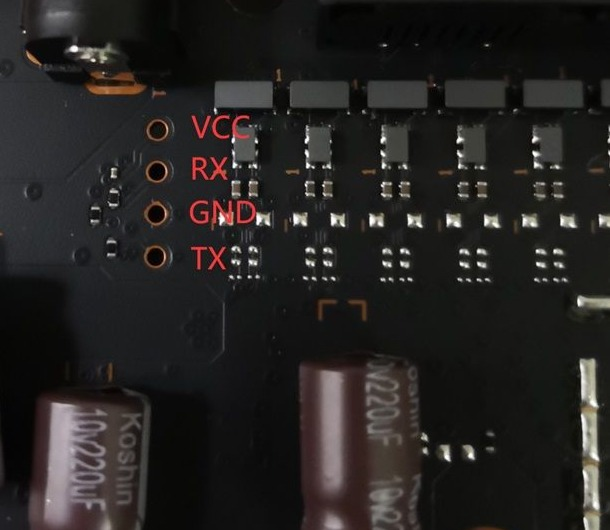

正在收一台二手的小米 AX3000T，准备刷 OpenWrt。机器还在路上，功课已经做完了，这篇把结果记一下：串口 TTL 的预留口藏在主板哪个位置、线怎么接，万一刷成砖了怎么靠它救回来。最后再把三条刷机路线的差别捋一遍。

## 先确认买的是哪一台

AX3000T 这个名字下面藏着三种硬件，买之前不挑清楚，后面全是白忙：

| 版本 | 硬件 | 出厂固件 | 备注 |
|---|---|---|---|
| V1 | MT7981B + MT7531AE 交换机 | 1.0.47 / 1.0.64 | 官方 OpenWrt 支持最成熟 |
| V2 | MT7981B + AN8855 交换机 + 新闪存（W25N01KV 那批） | 1.0.84 / 1.0.90 / 1.0.91 | 能刷，但 uboot 和固件都得挑文件名带 an8855 的，挑错就是砖 |
| V3 / RD03v2 | 高通 IPQ5018，还缩了一根 5G 天线 | 2.0.x | 社区只有实验性移植，不建议买 |

最省事的判法是进后台翻系统版本：1.0.x 是联发科版，2.0.x 是高通版。买之前摸不到后台，就拿手电照底壳散热孔：能照见覆铜、三根 5G 天线丝印的是联发科版；只剩长铝板、能照见 QCA 字样的是高通版。二手行情里联发科版 70 到 110 元算好价，低于这个数要留个心眼。你要是也在二手市场淘，别只盯着价格——版本挑错，便宜也是白花。

## 官方 wiki 查不到，去翻别人的拆机图

刷机步骤的教程满地都是，我更想先确认的是那个串口。平时它派不上用场，可真出了事，它是最后一道保命手段。

我原以为这种调试口的位置，官方 wiki 上会写得明明白白。让脚本去抓 OpenWrt 的 AX3000T 页面，抓回来的是一个 Anubis 挑战页，通篇 "Testing to determine if you are a bot!"。官方站点现在拿工作量证明挡爬虫，curl 这种抓法直接吃闭门羹。不过这类信息本来也不在官方那边。

真正的答案散在几个论坛帖里。OpenWrt 论坛那个 180490 的长帖，第 420 楼有一份很完整的 RD23 UART 安装教程，从拆机到接线全是实拍；恩山那边有 lgs2007m 整理的整套刷机和救砖教程；再就是几个中文博客的复述。把实拍图一张张下载回来对着看，位置就锁定了。

## 位置：电源口那一角，四颗没焊的孔

结论短得不像话：主板上有一排四个孔，未焊排针，2.54mm 间距，位置在电源接口那一角的板边附近。

<figure class="diagram">

<figcaption>图 1　四个预留孔和针序标注（底图为恩山实拍的裁剪，红字是后加的）</figcaption>
</figure>

<figure class="diagram">
<div class="diagram-box">
<svg xmlns="http://www.w3.org/2000/svg" viewBox="0 0 720 430" style="max-width:100%;height:auto" role="img" aria-label="AX3000T 主板串口预留孔位置示意">
  <rect x="0" y="0" width="720" height="430" fill="#ffffff"/>
  <text x="20" y="26" font-family="system-ui, sans-serif" font-size="15" font-weight="600" fill="#1f2937">小米 AX3000T 主板示意（俯视，未按比例）</text>
  <text x="20" y="46" font-family="system-ui, sans-serif" font-size="12" fill="#6b7280">整机只有这一处 4 孔串口，不拆机看不到，官方资料不标注</text>
  <rect x="40" y="64" width="640" height="336" rx="14" fill="#eef2f6" stroke="#c8d2dc" stroke-width="2"/>
  <g fill="#94a3b8" stroke="#7c899a" stroke-width="1">
    <rect x="96" y="66" width="56" height="26" rx="3"/>
    <rect x="166" y="66" width="56" height="26" rx="3"/>
    <rect x="236" y="66" width="56" height="26" rx="3"/>
    <rect x="306" y="66" width="56" height="26" rx="3"/>
  </g>
  <path d="M300 104 L 130 104 L 130 70" fill="none" stroke="#94a3b8" stroke-width="1.4"/>
  <text x="312" y="108" font-family="system-ui, sans-serif" font-size="12.5" fill="#475569">网口；WAN 是最靠近电源口的那个（通常从左数第一个）</text>
  <rect x="52" y="292" width="34" height="52" rx="4" fill="#64748b"/>
  <text x="46" y="366" font-family="system-ui, sans-serif" font-size="12.5" fill="#475569">DC 12V 电源口</text>
  <rect x="104" y="180" width="236" height="176" rx="12" fill="none" stroke="#f59e0b" stroke-width="1.6" stroke-dasharray="6 4"/>
  <text x="104" y="172" font-family="system-ui, sans-serif" font-size="12.5" fill="#b45309">电源口那一角的元件簇（认这一堆）</text>
  <rect x="120" y="196" width="52" height="34" rx="3" fill="#e2e8f0" stroke="#b6c2cf"/>
  <text x="126" y="211" font-family="system-ui, sans-serif" font-size="11" fill="#475569">二维码</text>
  <text x="126" y="223" font-family="system-ui, sans-serif" font-size="11" fill="#475569">贴纸</text>
  <g fill="#cbd5e1" stroke="#9aa8b6">
    <circle cx="146" cy="266" r="15"/>
    <circle cx="182" cy="266" r="15"/>
  </g>
  <text x="110" y="304" font-family="system-ui, sans-serif" font-size="11.5" fill="#475569">Koshin 电解电容</text>
  <g fill="#c4b5fd" stroke="#a78bfa">
    <rect x="228" y="252" width="16" height="28" rx="2"/>
    <rect x="250" y="252" width="16" height="28" rx="2"/>
  </g>
  <text x="200" y="304" font-family="system-ui, sans-serif" font-size="11.5" fill="#475569">紫色薄膜电容 ×2</text>
  <line x1="120" y1="340" x2="328" y2="340" stroke="#9aa8b6" stroke-width="1.4" stroke-dasharray="5 4"/>
  <text x="120" y="333" font-family="system-ui, sans-serif" font-size="11.5" fill="#475569">屏蔽罩边</text>
  <path d="M344 296 C 358 296, 364 292, 384 290" fill="none" stroke="#b45309" stroke-width="1.4"/>
  <g fill="#fbbf24" stroke="#b45309" stroke-width="1">
    <circle cx="396" cy="222" r="6"/>
    <circle cx="396" cy="252" r="6"/>
    <circle cx="396" cy="282" r="6"/>
    <circle cx="396" cy="312" r="6"/>
  </g>
  <g font-family="system-ui, sans-serif" font-size="12" fill="#dc2626">
    <text x="410" y="227">VCC</text>
    <text x="410" y="257">RX</text>
    <text x="410" y="287">GND</text>
    <text x="410" y="317">TX</text>
  </g>
  <g font-family="system-ui, sans-serif" font-size="11.5" fill="#6b7280">
    <text x="450" y="227">4 孔一排，未焊排针，2.54mm 间距</text>
    <text x="450" y="264">孔离板边只有几毫米，</text>
    <text x="450" y="281">孔旁基本没有可读丝印</text>
    <text x="450" y="318">一排孔从两个方向读，顺序互为镜像，</text>
    <text x="450" y="335">两套读法都对，别当成资料打架</text>
  </g>
</svg>
</div>
<figcaption>图 2　四个孔在主板上的大致方位：贴着电源口那一角的元件簇</figcaption>
</figure>

「在电源口附近」这种描述，拆开板子之后依然可能白找，因为那一片元件挤得厉害。好用的办法是认簇：几颗 Koshin 电解电容（1000µF、220µF 10V 那一档）、两颗紫色薄膜电容、一张二维码贴纸，加上黑色圆柱元件和屏蔽罩的边缘，这些东西基本堆在一处，四颗孔就紧贴它们旁边，离板边几毫米。你拆开之后照着这堆东西找就行，比记方位可靠。

孔周围基本没有丝印可认，个别照片里能勉强看出 J4 之类的编号。官方从不宣传这个口，第一次拆机很容易从它上面扫过去。

另有一件事得说清楚：以上说的是联发科版。高通版 RD03v2 上也有调试口，但位置针序都是另一套，别照抄这份。

## 接线：会踩的坑其实只有三个

四个孔排成一列，两个方向读出来的顺序互为镜像。恩山照片上的标注，一个方向是 VCC → RX → GND → TX；国际版教程的照片从对面拍过去，读出来就成了 TX → GND → RX → VCC。看到两套顺序别以为资料打架，那是同一排孔。

实际只用三根线：GND、RX、TX。VCC 不接，板子自己有电。RX 和 TX 要跟 USB-TTL 转接板交叉：板的 RX 接模块的 TX，板的 TX 接模块的 RX，GND 对 GND。转接板的跳线拨到 3.3V，串口参数 115200 8N1，别拿 5V 往上怼。

拿不准哪根是 GND 就先上万用表：跟屏蔽罩或网口金属壳导通的那一根就是。稳妥的顺序是只接 GND 和 TX 先看有没有日志出来，有输出了再补 RX。多花两分钟，比重插十次强。

<figure class="diagram">
<div class="diagram-box">
<svg xmlns="http://www.w3.org/2000/svg" viewBox="0 0 720 400" style="max-width:100%;height:auto" role="img" aria-label="USB-TTL 与主板串口的接线示意">
  <rect x="0" y="0" width="720" height="400" fill="#ffffff"/>
  <text x="20" y="26" font-family="system-ui, sans-serif" font-size="15" font-weight="600" fill="#1f2937">接线示意：三根线，VCC 不接</text>
  <text x="20" y="46" font-family="system-ui, sans-serif" font-size="12" fill="#6b7280">115200 8N1 ｜ 转接板跳线拨到 3.3V ｜ RX/TX 与转接板交叉</text>
  <rect x="60" y="84" width="180" height="216" rx="10" fill="#eef2f6" stroke="#c8d2dc" stroke-width="2"/>
  <text x="150" y="112" text-anchor="middle" font-family="system-ui, sans-serif" font-size="13" fill="#1f2937">USB-TTL 模块</text>
  <text x="150" y="132" text-anchor="middle" font-family="system-ui, sans-serif" font-size="11.5" fill="#6b7280">CH340 之类，跳线 3.3V</text>
  <g font-family="system-ui, sans-serif" font-size="12" fill="#334155" text-anchor="end">
    <text x="222" y="197">TX</text>
    <text x="222" y="232">RX</text>
    <text x="222" y="267">GND</text>
  </g>
  <g font-family="system-ui, sans-serif" font-size="11.5" fill="#6b7280" text-anchor="end">
    <text x="222" y="297">3V3</text>
  </g>
  <circle cx="240" cy="192" r="4.5" fill="#2563eb"/>
  <circle cx="240" cy="227" r="4.5" fill="#2563eb"/>
  <circle cx="240" cy="262" r="4.5" fill="#2563eb"/>
  <circle cx="240" cy="292" r="4.5" fill="#cbd5e1"/>
  <rect x="540" y="84" width="120" height="252" rx="10" fill="#eef2f6" stroke="#c8d2dc" stroke-width="2"/>
  <text x="600" y="112" text-anchor="middle" font-family="system-ui, sans-serif" font-size="13" fill="#1f2937">路由器 4 孔</text>
  <text x="600" y="132" text-anchor="middle" font-family="system-ui, sans-serif" font-size="11.5" fill="#6b7280">主板串口</text>
  <g fill="#fbbf24" stroke="#b45309" stroke-width="1">
    <circle cx="548" cy="162" r="5.5"/>
    <circle cx="548" cy="197" r="5.5"/>
    <circle cx="548" cy="232" r="5.5"/>
    <circle cx="548" cy="267" r="5.5"/>
  </g>
  <g font-family="system-ui, sans-serif" font-size="12" fill="#334155">
    <text x="562" y="167">VCC</text>
    <text x="562" y="202">RX</text>
    <text x="562" y="237">GND</text>
    <text x="562" y="272">TX</text>
  </g>
  <path d="M240 192 L 548 197" fill="none" stroke="#2563eb" stroke-width="2"/>
  <path d="M240 227 L 410 227 L 410 267 L 548 267" fill="none" stroke="#2563eb" stroke-width="2"/>
  <path d="M240 262 L 474 262 L 474 232 L 548 232" fill="none" stroke="#2563eb" stroke-width="2"/>
  <text x="300" y="185" font-family="system-ui, sans-serif" font-size="11.5" fill="#2563eb">模块 TX → 板 RX</text>
  <text x="300" y="221" font-family="system-ui, sans-serif" font-size="11.5" fill="#2563eb">模块 RX → 板 TX</text>
  <text x="300" y="256" font-family="system-ui, sans-serif" font-size="11.5" fill="#2563eb">GND ↔ GND</text>
  <path d="M548 162 L 604 162" fill="none" stroke="#dc2626" stroke-width="1.6" stroke-dasharray="5 4"/>
  <path d="M606 152 L 620 172 M 620 152 L 606 172" stroke="#dc2626" stroke-width="2"/>
  <text x="626" y="166" font-family="system-ui, sans-serif" font-size="11.5" fill="#dc2626">不接</text>
  <text x="60" y="344" font-family="system-ui, sans-serif" font-size="12.5" fill="#475569">稳妥顺序：万用表先找 GND（与屏蔽罩/网口金属壳导通的那根）→ 只接 GND + TX 看日志 → 有输出再补 RX</text>
  <text x="60" y="368" font-family="system-ui, sans-serif" font-size="12.5" fill="#475569">接触不良的典型表现是乱码，或握手阶段卡住不动</text>
</svg>
</div>
<figcaption>图 3　接线：三根线，VCC 不接，RX/TX 跟转接板交叉</figcaption>
</figure>

## 线怎么固定上去

两条路。拆机是正路：底壳标签纸下面有两颗螺丝，吹风机吹软背胶再撬上盖，然后焊一根 2.54 的 4P 排针，或者直接飞线。不拆机是恩山传出来的土办法：从底壳散热格栅的孔洞里伸细线进去顶住孔位，网线抽三芯、剥皮对折就能当探针用。土办法能用，线要固定好，别让裸线头碰到旁边的东西。

顺带提醒一句：这个串口不在板子边缘，市售那种 PCB 测试夹夹不住它。我原本打算买一对夹在板边了事，查完才知道根本用不上，这笔钱省了。

两种办法都会遇到同一个毛病：接触不良。表现是乱码，或者卡在握手阶段不动，恩山上有好几个人栽在这里。手上有手持 PCB 探针的话，压着用会稳很多。

## 这个口是给"砖"准备的

串口平时吃灰，主场是救砖。工具链叫 mtk_uartboot，配套文件两个：一个 bl2（`mt7981-ddr3-bl2-ram-boot.bin`），一个 fip（`mt7981_ax3000t-fip-debrick-only-fixed-parts-multi-layout_20241010.bin`）。流程里有个反直觉的点：先把 TTL 接好、路由器保持断电，先执行救砖命令，再给路由器上电。传输要三分钟左右，终端半天不动也别拔线。

刷机我会走正经路线，救砖这套东西就当保险绳挂在墙上。希望用不上，但得先在手里。

## 三条刷机路线，差别在哪

| 方案 | 引导程序 | 可用空间 | 什么时候选它 |
|---|---|---|---|
| A：XMiR-Patcher 直装 | 原厂 U-Boot 不动 | rootfs 约 40～60M | 只想快点跑起来，改动最小 |
| B：hanwckf 的 multi-layout U-Boot | 换成 hanwckf U-Boot，可选 default / 112m 布局 | 112m 布局下 rootfs_data 约 97M | 社区主流：自带 Web 刷机页，砖了不接线也能救 |
| C：官方 ubootmod | 换成 OpenWrt 官方 U-Boot | 112M 单 ubi | 想跟主线走、用官方 sysupgrade 的人 |

你要是只想让它快点跑起来，A 方案就够用；打算把它当长期折腾的玩具，再往 B 看。

三条路线的前置动作完全一样，而且它是所有步骤里最不能省的一步：进系统之后先把分区全量备份出来。做完这个，再碰别的东西。

```sh
cat /proc/mtd                                # 先看分区编号
dd if=/dev/mtd3 of=/tmp/mtd3_Factory.bin     # 按实际编号逐个 dd
scp root@192.168.31.1:/tmp/mtd*.bin .        # 拉回电脑
```

Factory 分区要排第一位。那是 Wi-Fi 的校准数据，一台机器一份，丢了这台路由器就永远只是台交换机。后面是 BL2 和 FIP。想能完整回滚原厂，就把 mtd0 到 mtd9 全部拉下来。

方案 B 的步骤不复杂：先照 A 的前几步把 SSH 开好、备份做完，先别装系统；然后按版本挑 uboot 文件写进 FIP 分区，V1 和 V2 的文件名不一样，V2 那份带 an8855 字样——这一步选错文件，基本就是直接进救砖流程。写完断电，按住 reset 上电，灯变蓝松手，电脑设静态 IP 192.168.1.100，进 192.168.1.1 的 U-Boot 网页，先选布局再传固件。刷 112m 系列的 ImmortalWrt 选 immortalwrt-112m，刷原厂备份或 stock 版固件选 default；带 ubootmod 字样的固件不能在这里刷，它要配官方的那套。布局选错不算致命，重新进 U-Boot 换一个再来就行。

两条铁律：刷 FIP 和切布局的过程中绝对不能断电；换布局必须在 U-Boot 里连固件一起重刷，不能在系统里混着刷。

## 砖了之后的三道防线

按严重程度排：

1. U-Boot 还活着。这是最常见的情况，多半只是固件刷坏。断电按住 reset 上电，进 U-Boot 的网页重刷，或者走 TFTP 恢复，九成的"砖"到这一步就活了。
2. U-Boot 也挂了，比如刷 FIP 的时候断电、布局选错。这时候才轮到串口上场：用前面接好的 TTL 跑 mtk_uartboot，先执行命令再上电，传完浏览器开 192.168.1.1/uboot.html 重新刷。
3. 从来没动过原厂 U-Boot。直接用小米官方的修复工具走 TFTP 恢复原厂，比什么花招都省事。

最坏的情况是三条都走不通。真到这步，板子还能上编程器，但那是另一个话题了。

## 想回原厂

U-Boot 网页里选 default 布局，把备份的 mtd8、mtd9 刷回去。中途换过 FIP 的，记得把原厂 FIP 的备份也写回 FIP 分区，不然引导的还是 hanwckf 那套。第一次开机 LED 慢慢闪、自动重启三次，都算正常。恢复之后别在小米系统里点固件升级，要更新只能再走一遍 U-Boot 刷 mtd8/mtd9。

## 资料清单

- OpenWrt 固件选择器：firmware-selector.openwrt.org（mediatek/filogic → xiaomi_mi-router-ax3000t）
- ImmortalWrt 固件选择器：firmware-selector.immortalwrt.org
- hanwckf 的 U-Boot：github.com/hanwckf/bl-mt798x
- AX3000T 专用的 ImmortalWrt + U-Boot 打包：github.com/hkint/xiaomi-ax3000t-immortalwrt-hanwckf-firmware-build
- 解锁 SSH 的 XMiR-Patcher：github.com/openwrt-xiaomi/xmir-patcher
- 救砖文件和教程：github.com/lgs2007m/Actions-OpenWrt
- 串口救砖图文：cnblogs.com/p123/p/18046679
- 论坛帖：forum.openwrt.org 的 180490（首帖是一图流，RD23 保姆教程在第 420 楼）；恩山 8472190、8425110、8312446

机器到货拆开之后，我会再拍几张照片核对孔位和针序。要是跟这份笔记有出入，回来改。
